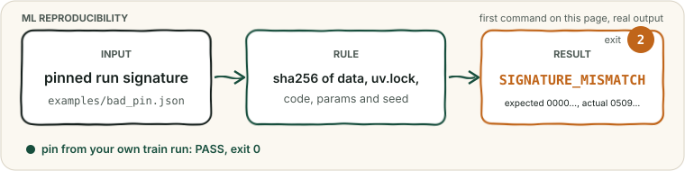

# repro-ml

**CI retrains your model and the tests pass, even when the data, the locked dependencies or the code under it have changed since the run you approved.**

[](https://github.com/homayoun-safarpour/repro-ml-pipeline/actions/workflows/ci.yml)


ML reproducibility: local-first sklearn to MLflow to FastAPI with a full-run signature verified in CI.

repro-ml is a small scikit-learn, MLflow and FastAPI path for one classifier that pins a run signature after training and checks it in CI. We built it because an MLflow run ID names a logged experiment but does not show that the next CI job trained on the same inputs. Given a pinned signature file, `repro-ml verify-signature` recomputes one SHA-256 digest from the dataset hash, the `uv.lock` hash, the package source, the parameters and the seed, and compares it with the pin. It returns `PASS` with exit 0 or `SIGNATURE_MISMATCH` with exit 2, so that a CI job can stop when any of these inputs has changed. This repository's own CI checks the committed pin `examples/artifacts/run_signature.json`.

```bash
git clone https://github.com/homayoun-safarpour/repro-ml-pipeline
cd repro-ml-pipeline && uv sync --frozen
uv run repro-ml verify-signature --pin examples/bad_pin.json
```

```text
verdict: SIGNATURE_MISMATCH
  expected=0000000000000000... actual=e5dd67abf427480e...
```

That command exits 2, because `examples/bad_pin.json` holds a zeroed signature. A pin written by your own `repro-ml train` run exits 0 (see [How it works](#how-it-works)).



[How it works](#how-it-works) · [Results](#what-each-result-means) · [Limits](#limits) · [Cite](#citation) · Part of [a small open stack for checking AI agents and their judges](https://homayoun-safarpour.github.io)

## What each result means

| Verdict | Exit | Meaning |
|---|---|---|
| `PASS` | 0 | The digest recomputed from the current data, lock file, package source, the pin's parameters and the pin's seed equals the pinned signature, and every field in the pin's `meta` equals the recomputed one. |
| `SIGNATURE_MISMATCH` | 2 | At least one of those inputs differs from the pinned run. The output shows the first 16 characters of both digests and a `changed:` line naming the fields that differ. If the data file no longer matches the hash or shape in its manifest, it shows a `data:` line instead. |
| `BAD_PIN` | 1 | The pin file is missing, is not JSON, or lacks a 64-character hex `signature` or a `meta` with `params` and an integer `seed`. No signature is computed. |
| `BAD_INPUT` | 1 | The data or manifest file is missing, unreadable or malformed. No signature is computed. |
| Usage message | 1 | A required argument such as `--pin` is missing. Exit 2 always means `SIGNATURE_MISMATCH`. |

A `PASS` shows that the recorded inputs of a run are the same as those of the pinned run. It does not show that the installed packages match `uv.lock`, that the model is accurate on other data, or that the served model is the pinned one.

## Use this when

| Situation | Use repro-ml? |
| --- | --- |
| You train a scikit-learn model in CI and want the job to fail when data, lock file, code, parameters or seed change | Yes |
| You want a local scikit-learn to MLflow to FastAPI path with no paid service | Yes |
| You need an MLOps platform for many models | No. This repository covers one fixed classifier; use MLflow and your own platform directly |
| You need GPU training | No |

Install with `uv sync --frozen` rather than `pip install -e .`. The signature hashes the `uv.lock` file, not the installed packages, so a `pip install -e .` environment would still pass the check while it runs versions that the lock does not name.

## The problem

A training job can finish with the usual metrics after its inputs have changed: new bytes in the data file, other versions in the lock file, a source edit or a new seed. MLflow records each run, but it does not compare the next run with the one that was approved. repro-ml writes that comparison down as one pinned digest and fails when the digest changes.

## How it works

1. `repro-ml train` checks the committed CSV against its manifest, trains a scaled logistic regression with five-fold cross-validation and a 25% holdout, writes `run_signature.json`, logs the run to MLflow and points the `champion` registry alias at the new model version.
2. `repro-ml verify-signature` recomputes the digest and compares it with the pin.
3. `repro-ml predict` loads the model through its registry URI and scores the first row of the committed dataset.

```bash
uv run repro-ml train --artifact-dir .local-artifacts
uv run repro-ml verify-signature --pin .local-artifacts/run_signature.json
uv run repro-ml predict \
  --tracking-uri sqlite:///examples/artifacts/mlflow.db \
  --model-uri models:/repro-ml-classifier@champion
```

Output of the three commands (the run ID differs on each run, and MLflow writes its own log lines to stderr):

```text
run_id=fa64df3fc6f340f68912f13b11c402c8 accuracy=0.9860 f1=0.9889 signature=e5dd67abf427480e...
verdict: PASS
{"prediction": 0, "model_uri": "models:/repro-ml-classifier@champion"}
```

The signature holds the manifest version and the SHA-256 of the CSV, the SHA-256 of the copy of `uv.lock` in `src/repro_ml_pipeline/resources/` (a test checks that it equals the root `uv.lock`), one SHA-256 over every `.py` file in the package, the parameters stored in the pin, and the seed stored in the pin (`--random-state` overrides it, and a value that differs from the pin is a mismatch).

| Module | What it does |
|---|---|
| `repro_ml_pipeline.data` | Loads the CSV and checks its hash, shape and binary target against the manifest |
| `repro_ml_pipeline.signature` | Builds the signature payload and digest, and compares a digest with a pin |
| `repro_ml_pipeline.train` | Cross-validates, trains, writes the pin and logs the run to MLflow |
| `repro_ml_pipeline.registry` | Registers a model version, sets the alias and loads a model by URI |
| `repro_ml_pipeline.serve` | The FastAPI app with `/health`, `/ready`, `/metadata` and `/predict` |
| `repro_ml_pipeline.cli` | The `train`, `verify-signature` and `predict` commands |

Named tests: `test_full_signature_covers_data_environment_code_params_and_seed`, `test_signature_changes_when_params_change`, `test_check_signature_mismatch_exit_semantics`, `test_data_quality_rejects_content_drift`, `test_metric_regression_floor`, `test_cli_train_and_verify`, `test_committed_pin_verifies_with_exit_0` and `test_edit_to_package_source_or_lock_makes_committed_pin_fail`.

Interview pack: [docs/INTERVIEW.md](docs/INTERVIEW.md).

### Serve the registered model

```bash
MLFLOW_TRACKING_URI=sqlite:///examples/artifacts/mlflow.db \
MODEL_URI=models:/repro-ml-classifier@champion \
uv run uvicorn repro_ml_pipeline.serve:app --port 8000
```

`GET /health` checks the process, `GET /ready` loads the model through its registry URI, `GET /metadata` returns the model version, run ID, data hash, code revision and signature, and `POST /predict` rejects a request without exactly 30 numeric features (HTTP 422).

### Recorded benchmark

`uv run python scripts/run_benchmark.py` trains twice with seed 42 and writes [`examples/benchmark_reproducibility.md`](examples/benchmark_reproducibility.md). The committed report records equal signatures and metrics for both runs, a holdout accuracy of 0.986014, a five-fold CV accuracy of 0.978878 +/- 0.008790, and `SIGNATURE_MISMATCH` (exit 2) when `C` changes from 1.0 to 0.5.

## Limits

- It is not an MLOps platform, since it trains one logistic-regression classifier on the committed Wisconsin Diagnostic CSV, with no GPU training and no deployment to a hosted runtime.
- Any edit to a `.py` file in the package changes the code hash, including edits to `cli.py` or `serve.py`, so CI fails on every source edit until the committed pin is renewed. To re-pin after a reviewed change, run `uv run repro-ml train --artifact-dir .local-artifacts`, copy `.local-artifacts/run_signature.json` over `examples/artifacts/run_signature.json` and commit it with the change.
- The serving tests use a stand-in model manager. The real registry path behind the API is exercised by the `docker-smoke` CI job.
- The benchmark shows repeatability on this data and pipeline, not generalisation to another population. The package needs Python 3.10, 3.11 or 3.12, as `pyproject.toml` states.

## CI and release

- CI installs `uv.lock`, runs ruff and pytest on Python 3.10, 3.11 and 3.12, verifies the committed pin `examples/artifacts/run_signature.json` before the tests, then trains once and checks that the fresh pin is byte for byte the committed one, on each version. A change to the data, lock file, package source, parameters or seed fails the job until a reviewed commit re-pins. A `docker-smoke` job starts the MLflow tracking server, a one-shot trainer and the API with Docker Compose and calls `/ready`, `/metadata` and `/predict`; a recorded run is in [`examples/docker_smoke.txt`](examples/docker_smoke.txt).
- Pushing a `v*` tag reruns the gates, builds wheel and sdist files, publishes a versioned image to GitHub Container Registry and creates a GitHub Release. No workflow deploys to an external runtime.

## How we did it

1. Kept MLflow's documented sklearn logging and registry interfaces.
2. Replaced an implicit sklearn data loader with a versioned CSV, a source record and a hash.
3. Expanded the gate from data and parameters to the complete run identity.
4. Split process health from model readiness and made inference resolve a registry URI.
5. Kept local SQLite and committed data, so that the core path does not depend on hosted systems.

## Contributing

Read [`CONTRIBUTING.md`](CONTRIBUTING.md). Changes to data, signatures, training or dependencies must rerun the benchmark. Small extension ideas are listed there and in the issue template.

## Related tools

- [judge-reliability-kit](https://github.com/homayoun-safarpour/judge-reliability-kit)
- [agent-loop-engine](https://github.com/homayoun-safarpour/agent-loop-engine)
- [judge-field-guide](https://github.com/homayoun-safarpour/judge-field-guide)

## Citation

Use the "Cite this repository" button on GitHub, which reads [`CITATION.cff`](CITATION.cff).

Author: Homayoun Safarpour. [LinkedIn](https://www.linkedin.com/in/homayoun-safarpour/)

## License

MIT. See [`LICENSE`](LICENSE).
